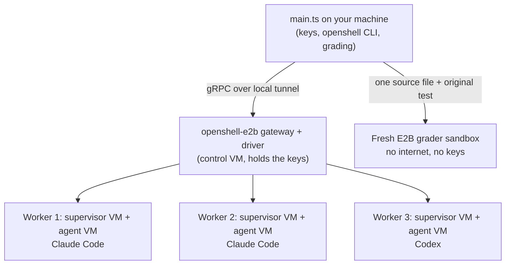

# Run a fleet of coding agents under NVIDIA OpenShell on E2B: Claude Code and Codex

This example starts three coding agents in parallel, one bug each: two Claude Code workers and one Codex worker. Each worker runs in its own [NVIDIA OpenShell](https://github.com/NVIDIA/OpenShell) sandbox on E2B, through the [openshell-e2b](https://github.com/e2b-dev/openshell-e2b) compute driver.

- **The keys stay outside.** The Anthropic and OpenAI keys go into OpenShell providers on the gateway. Inside each sandbox, the key is a placeholder. The supervisor adds the real key only to that agent's API host, for that agent's binary.
- **Nothing else is reachable.** The sandboxes get no other network rule. Every other request the agents make is denied and recorded.
- **The script does not trust the agents.** Only the assigned source file comes back from a worker. The original test runs against it in a fresh E2B sandbox with no internet and no keys.

https://github.com/user-attachments/assets/b5acbb8b-c4c8-4635-bd40-0a2536d5e405

## Where the components run



Each worker uses two E2B microVMs, the gateway one more, and each grader one. A run uses up to ten E2B sandboxes at once. Check your plan's concurrency limit.

## Set up the gateway (once)

Requires Node 22.18 or later, an [E2B API key](https://e2b.dev/dashboard), an [Anthropic API key](https://console.anthropic.com) and an [OpenAI API key](https://platform.openai.com/api-keys).

In a checkout of [openshell-e2b](https://github.com/e2b-dev/openshell-e2b) (OpenShell v0.1.9, with the agent template from e2b-dev/openshell-e2b#13), follow its README to build its templates into your E2B team, plus the two-agent worker template. Then keep the gateway tunnel open with that worker:

```bash
npm run template:workload:agents
OPENSHELL_WORKLOAD_TEMPLATE=openshell-workload-agents npm run connect
```

The worker template is E2B's `claude` template plus the OpenShell worker layers, the Codex CLI and its `codex-code-mode-host`, both pinned and SHA-256 verified.

## Run the fleet

```bash
npm install
cp .env.example .env   # set E2B_API_KEY, ANTHROPIC_API_KEY, OPENAI_API_KEY and OPENSHELL_E2B_DIR
npm start
```

The script imports the two provider profiles, [fleet-claude-code.yaml](./fleet-claude-code.yaml) and [fleet-codex.yaml](./fleet-codex.yaml), and creates one provider per key. Then each worker:

1. creates an OpenShell sandbox with its provider, and uploads [repo/](./repo), a tiny library with three real bugs and failing tests;
2. checks that its key inside the VM is an `openshell:resolve:…` placeholder;
3. runs its agent headless on one issue: `claude -p` or `codex exec`;
4. sends only its source file back, which is graded with the original test in a fresh offline E2B sandbox;
5. reads its sandbox's OpenShell log.

A run on 2026-11-27 took 62 s:

```text
Results (62 s wall clock; graded with the original tests in a fresh offline sandbox)
  ✓ [1] claude 1-slugify   57 s
  ✓ [2] claude 2-duration  62 s
  ✓ [3] codex  3-csv       58 s

OpenShell
  [1] claude 5 requests to api.anthropic.com + 10 other API routes with the key · denied: claude http-intake.logs.us5.datadoghq.com
  [2] claude 6 requests to api.anthropic.com + 10 other API routes with the key · denied: claude downloads.claude.ai, claude http-intake.logs.us5.datadoghq.com
  [3] codex  4 requests to api.openai.com · denied: git-remote-http github.com, codex api.github.com, codex chatgpt.com, codex ab.chatgpt.com
```

What the log shows:

- **Codex tries the internet on its own.** It went for `github.com`, `api.github.com`, `chatgpt.com` and `ab.chatgpt.com`. No rule allows them, so OpenShell denied them and recorded the program.
- **Claude Code's telemetry and updater are denied** (`http-intake.logs.us5.datadoghq.com`, `downloads.claude.ai`).
- **The key reaches more than inference.** Besides `POST /v1/messages`, Claude Code used its key on about ten other `api.anthropic.com` routes (settings, metrics, event logging). The provider grants the whole host. The receipt lists the routes.

The receipt (`out/agents-<id>.json`) has, per worker: the agent's exit status, the grade, whether the tests were changed, the requests on the model host, and every denial. `out/` also keeps each agent's output and each sandbox's raw audit log. The script exits with 1 if a worker fails. It deletes the sandboxes and providers it created, also on Ctrl+C.

## Codex under OpenShell

Three things make Codex work in an OpenShell sandbox. [src/agents.ts](./src/agents.ts) has them:

- OpenShell sets the placeholder only under the variable the key came from (`OPENAI_API_KEY`). Codex reads that variable only through a model provider's `env_key`, so the script passes a provider with `-c`. No `codex login` is needed.
- The same provider sets `supports_websockets = false`. OpenShell's REST rule refuses a WebSocket upgrade, and Codex tries one first.
- Codex runs with `--dangerously-bypass-approvals-and-sandbox`, because OpenShell is the sandbox. Codex needs `codex-code-mode-host` next to `codex` to run commands; the template installs it.

## Limits

- The provider grants the whole API host for the agent's binary and every program it starts, not only the inference route. Use project-scoped keys with a spend limit.
- OpenShell delivers its log on a best-effort basis. The script fails a worker whose log has no inference request, rather than report an empty record as clean.
- The grader checks behavior against the original tests. It does not review the code.
- The openshell-e2b driver uses one worker template for all sandboxes on a gateway, selected when the gateway starts. That is why one template carries both agents.

## Files

| File | What it owns |
| --- | --- |
| [src/main.ts](./src/main.ts) | Providers, the three workers, grading, the receipt and cleanup. |
| [src/agents.ts](./src/agents.ts) | The provider profiles in use and the headless command for each agent. |
| [src/audit.ts](./src/audit.ts) | Reading OpenShell's log: inference requests, other routes, unexpected destinations, denials. |
| [src/openshell.ts](./src/openshell.ts) | The `openshell` CLI from your openshell-e2b checkout. |
| [repo/](./repo) | The library the agents fix: three bugs, three failing tests, three issues. |

## Offline checks

```bash
npm test
npm run typecheck
```

The tests create no sandbox. They parse audit lines recorded from a live gateway (Claude Code's inference and other routes, Codex's and git's denials) and check the agent commands (the Codex provider settings, and that shell syntax in an issue name or model id is refused).
