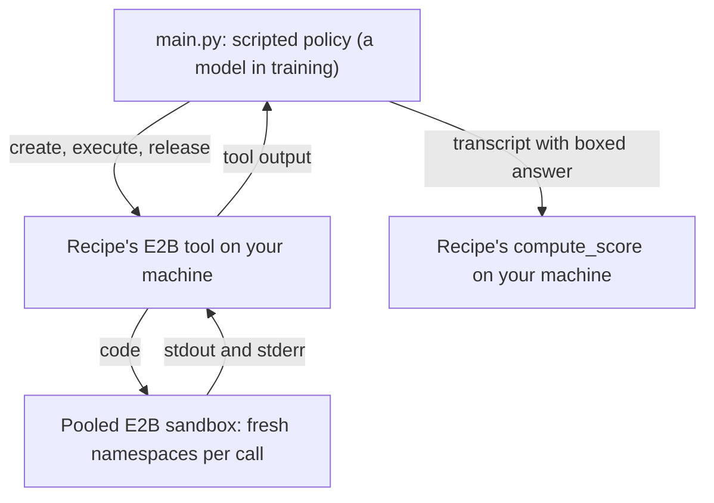

# Code execution for verl ReTool with E2B

Replay three ReTool trajectories through the [verl ReTool recipe](https://github.com/verl-project/verl-recipe/tree/main/retool)'s E2B tool and score them with the recipe's own reward. A fixed policy writes the code and reads the tool output in place of a model, so the first result needs no GPU and no model. The same tool config then switches a real ReTool training run to E2B.

[verl](https://github.com/verl-project/verl/tree/v0.9.1) trains language models with reinforcement learning. In ReTool, the model solves math problems by writing Python, reading what it printed and continuing to reason. E2B runs that Python in cloud sandboxes, so you do not deploy a code execution service next to your GPUs. The [integration guide](https://docs.e2b.dev/agents/verl) explains the tool's pool, isolation and failure behavior.

## Where the components run



`main.py` calls the tool exactly the way verl's agent loop does: `create`, `execute` and `release` for every call. The reward function is the one the recipe passes to verl as `custom_reward_function`.

## Run the scripted trajectories

The commands use Python 3.12; the example supports Python 3.11 and 3.12, like verl 0.9.1 with the E2B SDK. You also need [uv](https://docs.astral.sh/uv/getting-started/installation/), Git and an [E2B API key](https://docs.e2b.dev/api-key). The run creates two short-lived sandboxes from the `code-interpreter-v1` template and removes them at the end.

From this directory:

```bash
uv sync --locked --python 3.12
./get_recipe.sh
cp .env.example .env
```

`uv.lock` pins verl 0.9.1 and the E2B SDK 2.64.0. The recipe is not a separate package: verl imports it as the `recipe` folder, so [get_recipe.sh](./get_recipe.sh) checks out the tested `verl-recipe` revision into `./recipe`.

Set `E2B_API_KEY` in `.env`, then run:

```bash
uv run --locked --env-file .env python main.py
```

verl first prints the tool's schema while it loads the config. Then the script prints one trace per trajectory:

```text
== remainder: reward 1.0, num_turns 4
   tool: 649
   boxed answer: 649
== fix-after-error: reward 1.0, num_turns 6
   tool: NameError: name 'cont' is not defined. Did you mean: 'count'?
   tool: 400
   boxed answer: 400
== wrong-answer: reward -0.9, num_turns 4
   tool: 115
   boxed answer: 116
```

It ends with a JSON receipt:

```json
{
  "run_tag": "fa155686657d",
  "rewards": {
    "remainder": 1.0,
    "fix-after-error": 1.0,
    "wrong-answer": -0.9
  },
  "rewards_match_across_copies": true,
  "trajectories": 12,
  "tool_calls": 16,
  "unavailable_calls": 0,
  "pool_size": 2,
  "sandboxes_in_pool": 2,
  "call_seconds": {
    "min": 0.582,
    "median": 1.069,
    "max": 2.344
  },
  "elapsed_seconds": 2.388,
  "sandboxes_left_after_close": 0
}
```

Your `run_tag` and timings will differ. The script exits with an error if any call could not run or if a sandbox was still running after cleanup.

## What each trajectory shows

| Trajectory | Tool calls | What happens | Reward |
| --- | --- | --- | --- |
| `remainder` | 1 | `pow(7, 2026, 1000)` prints `649`; the policy boxes it. | `1.0` |
| `fix-after-error` | 2 | The first code has a typo and returns a `NameError` traceback as text. The policy fixes it, gets `400` and boxes it. | `1.0` |
| `wrong-answer` | 1 | The tool returns the correct `115`, but the policy boxes `116` on purpose. | `-0.9` |

The policy reads its answer from the tool output, so a sandbox that returned the wrong text would show up as a wrong reward. Each code turn goes through the recipe's `normalize_code` inside the tool: the last line is wrapped in `print(...)`, which is why the code above has no explicit `print`.

The reward comes from [retool.py](https://github.com/verl-project/verl-recipe/blob/main/retool/retool.py) `compute_score`: `1.0` for a correct `\boxed{}` answer, `-1.0` otherwise, and a wrong answer earns back `0.1` for every tool call, down to at most `-0.6`. `num_turns` counts the prompt, each model turn and each tool response, as verl does: one tool call gives 4 turns, two give 6.

## What the receipt measures

The script runs `--copies` (default 4) copies of each trajectory at the same time through one tool with `--pool-size` (default 2) sandboxes, the way one verl agent loop worker serves many conversations.

| Field | Meaning |
| --- | --- |
| `rewards_match_across_copies` | Every concurrent copy got the same reward as the first, so calls did not see each other's state. |
| `tool_calls`, `sandboxes_in_pool` | 16 calls were served by 2 sandboxes; the pool reuses them instead of creating one per call. |
| `call_seconds` | Time of one `create`/`execute`/`release` sequence, including waiting for a free sandbox and creating the first ones. |
| `elapsed_seconds` | Wall time for all trajectories. |
| `unavailable_calls` | Calls that got the tool's "temporarily unavailable" text after a retry. Must be `0`. |
| `sandboxes_left_after_close` | Sandboxes with this run's tag still running after `tool.close()`. Must be `0`. |

Compare `--pool-size 1`: on this small workload it finished in 1.5 s against 2.4 s for two sandboxes, because the tool waits `create_interval` (2 s) before creating a second sandbox and the calls are short. A larger pool pays off only when calls actually wait for a free sandbox; raise `--copies` to see where that happens. Keep the pool within your plan's concurrent sandbox limit.

The receipt above comes from one run on 2026-11-17 on a laptop in Europe, with the default `code-interpreter-v1` template (2 vCPU). It shows the shape of the output; it is not a latency benchmark. To estimate sandbox cost, multiply the time the sandboxes existed by the template's per-second rate from [current pricing](https://e2b.dev/pricing).

## Switch a ReTool training run to E2B

Training needs the recipe's GPU setup; follow the [ReTool README](https://github.com/verl-project/verl-recipe/tree/main/retool) for the model, datasets and hardware. In that environment, install the SDK and add one override:

```bash
pip install e2b
export E2B_API_KEY="e2b_***"

bash recipe/retool/run_qwen2-32b_dapo.sh \
    actor_rollout_ref.rollout.multi_turn.tool_config_path=recipe/retool/e2b_tool_config.yaml
```

The key must reach the Ray workers that run the agent loop, not only the shell that starts training. Size the pool with `pool_size` × `actor_rollout_ref.rollout.agent.num_workers` within your plan's concurrent sandbox limit; the guide's [account limits](https://docs.e2b.dev/agents/verl#account-limits-and-cost) section has the numbers for Hobby and Pro. This example does not run training.

## Cleanup

`main.py` calls `tool.close()`, which kills the pool, then lists sandboxes with this run's `cookbook-run` metadata tag and kills any that remain. In training nothing has to be closed: a sandbox that gets no calls for `sandbox_timeout` seconds (600 by default) is removed by E2B. If the script is interrupted, its sandboxes expire the same way. They carry the `cookbook-run` metadata tag printed as `run_tag`, so you can list them with the SDK's `Sandbox.list` and kill them sooner.

## Troubleshooting

| Symptom | What to check |
| --- | --- |
| `ModuleNotFoundError: No module named 'recipe'` | Run `./get_recipe.sh` and start the script from this directory. |
| `CustomE2BSandboxTool requires the E2B_API_KEY environment variable` | Set the key in `.env` and pass `--env-file .env`. |
| `AuthenticationException` after `could not be created` warnings | The key is invalid. Create or copy it again as described in [API key](https://docs.e2b.dev/api-key). |
| `E2B could not run some calls` | Read the warning above it: rate limits, a wrong `template` or a service problem. |
| A reward differs from the table | Compare the printed tool output with the table. A different last line means the sandbox returned different text. |

## Offline checks

```bash
uv run --locked pytest -q
uv run --locked ruff check .
uv run --locked ruff format --check .
```

The tests replace the E2B tool with a local stand-in and check the rewards and turn counts; they create no sandbox. The tool itself is tested in the recipe repository. The root cookbook runner excludes this example because it creates its own sandboxes from the host.
